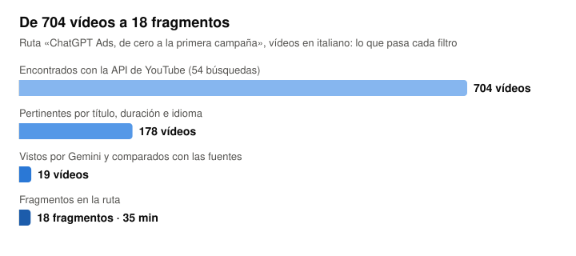
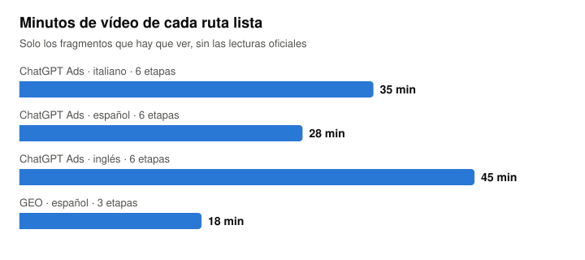

# Open Escool

**Italiano:** [leggi in italiano](README.it.md) · **English:** [read in English](README.en.md)

**Tu escuela personal hecha de vídeos gratuitos.** Eliges un tema y tu asistente (Claude Code o Codex) hace el resto:
- busca las fuentes oficiales y te enseña el mapa de la ruta;
- encuentra en YouTube los mejores vídeos;
- se los da a ver a Gemini para comprobarlos con las fuentes;
- te prepara una ruta por etapas con los fragmentos justos.

Mientras miras, le preguntas lo que no entiendes. Conoce el vídeo, los conceptos oficiales de la etapa y tus notas.

Todo funciona en tu ordenador (Mac o Windows). Las API que usa son gratuitas y las preguntas van por la suscripción a Claude o
ChatGPT que ya tienes.

<picture>
  <source media="(prefers-color-scheme: dark)" srcset="docs/img/filtros-oscuro.svg">
  
</picture>

## Cómo funciona

1. **Fuentes antes que vídeos.** El mapa de la ruta sale de la documentación oficial, con la frase copiada para cada concepto.
   Tú lo apruebas antes de buscar vídeos.
2. **Vídeos con la API oficial de YouTube.** Nada de descargas ni de scraping: búsqueda con la API y reproductor integrado.
3. **Gemini ve cada vídeo** desde su enlace público y escribe una ficha:
   - capítulos al minuto;
   - lo que dice el vídeo comparado con las fuentes: correcto, superado o equivocado;
   - el mejor fragmento para cada etapa.
4. **La ruta** reúne los fragmentos: casi todos los buenos tutoriales tocan varias etapas, así que la ruta usa solo los minutos
   que sirven. Una etapa sin un vídeo que la cubra queda como «hueco declarado», con las lecturas oficiales.
5. **Lección generada (opcional).** Una etapa puede convertirse en un vídeo de 3-6 minutos con fichas animadas. Se escribe solo
   con las fuentes oficiales y se lee con una voz gratuita en tu ordenador o con una voz de ElevenLabs.

<picture>
  <source media="(prefers-color-scheme: dark)" srcset="docs/img/rutas-oscuro.svg">
  
</picture>

## Instalar

Pega esto en **Claude Code** o **Codex**:

```
Instala Open Escool desde https://github.com/marketingaios/open-escool: clónalo en una carpeta mía y sigue /escool install (en Codex $escool install).
```

A mano:
1. Clona o descarga el repositorio.
2. Ejecuta el instalador:
   - Mac: `sh installa.sh`
   - Windows: `powershell -ExecutionPolicy Bypass -File installa.ps1`
3. En el navegador, «Instalar Open Escool» pone el icono en el Dock o en el menú Inicio.

Necesitas Python 3.10 o más y dos claves gratuitas, YouTube y Gemini ([docs/chiavi.md](docs/chiavi.md)). Para las lecciones
generadas el instalador añade Node, ffmpeg, Remotion y la voz gratuita: unos 2 GB y 10-30 minutos.

## Usar: un solo comando

En Claude Code `/escool`, en Codex `$escool`. Solo, enseña el estado de tus rutas y un menú. Las palabras van en inglés y valen
también en italiano y en español:

| Comando | Qué hace |
|---|---|
| `/escool create "tema"` (crear) | una ruta nueva: preguntas, fuentes, mapa para aprobar, vídeos, fichas |
| `/escool update <ruta> [etapa]` (actualizar) | vuelve a leer las fuentes y rehace solo las etapas que han cambiado |
| `/escool reinforce <ruta> <etapa>` (reforzar) | busca un vídeo más donde has tenido dudas |
| `/escool lesson <ruta> <etapa>` (lección) | la lección generada de una etapa |
| `/escool language <ruta> es` (idioma) | la misma ruta con vídeos en otro idioma (it, es, en) |
| `/escool customize` (personalizar) | nombre, logo, colores, idioma, disposición, asistente, perfil |
| `/escool start` (iniciar) | abre la plataforma en <http://127.0.0.1:8765> |
| `/escool diagnose` (diagnóstico) | un informe para quien te ayuda; con `--condividi`, la versión para una incidencia pública |

En la plataforma:
- **chat** al lado del vídeo, sobre el vídeo o sobre toda la ruta;
- **notas** con el minuto y «No lo entendí aquí»;
- **señal de hueco** cuando una etapa acumula dudas, y **repaso** construido sobre tus dudas;
- **teléfono** por el Wi-Fi de casa con un código;
- **exportar e importar** rutas, sin notas ni chat.

## Rutas listas

| Ruta | Vídeos en | Etapas | Minutos |
|---|---|---|---|
| ChatGPT Ads, de cero a la primera campaña | italiano · español · inglés | 6 | 35 · 34 · 45 |
| GEO: que la IA encuentre y cite tu web | español | 3 | 18 |

Las rutas guardan solo el ID de cada vídeo y textos propios (fragmento, resumen, avisos). Título, canal, fecha y duración los
pide la plataforma a YouTube con tu clave y los renueva cada 25 días: las [políticas para desarrolladores de YouTube](https://developers.google.com/youtube/terms/developer-policies)
(III.E.4) no permiten guardar esos datos más de 30 días.

## Privacidad

- Tus notas, chats, progreso y perfil se quedan en `utente/`, en tu ordenador.
- Las preguntas van solo al asistente que eliges (Claude Code o Codex, con tu cuenta).
- A Gemini llegan solo el enlace del vídeo público y el mapa de la ruta. Con el plan gratuito, Google puede usar lo que recibe.
- Al usar las funciones de YouTube aceptas las [Condiciones de servicio de YouTube](https://www.youtube.com/t/terms); los datos
  que YouTube trata siguen la [Política de privacidad de Google](https://policies.google.com/privacy).
- Desde el teléfono la plataforma se abre solo en la red de casa, con el código; el terminal y el diagnóstico no se abren desde
  allí. «Código nuevo» desconecta todos los teléfonos.

## Licencia

[PolyForm Noncommercial 1.0.0](LICENSE): puedes usar, copiar y modificar Open Escool para fines **no comerciales** (uso
personal, estudio, investigación, organizaciones sin ánimo de lucro).

Los vídeos de YouTube son de sus autores y se ven con el reproductor oficial. El nombre y el logo de Ismagit (`web/marca/`) no
están incluidos en la licencia.

Dependencias de las lecciones, cada una con su licencia:
- Remotion: gratis para personas y empresas de hasta 3 personas, de pago por encima (<https://www.remotion.dev/license>);
- fuente Geist: OFL;
- voces Chatterbox Multilingual (MIT), Supertonic 3 (modelo OpenRAIL-M, código MIT) y Kokoro-82M (Apache 2.0, kokoro-onnx MIT);
- mlx-audio, ONNX Runtime y faster-whisper: MIT.

## Contribuir

Se aceptan correcciones pequeñas, sin compromiso de tiempos: [CONTRIBUTING.md](CONTRIBUTING.md). Para un problema de seguridad,
el aviso privado: [SECURITY.md](SECURITY.md).

## Cómo está hecha

- `accademia.py`: el servidor local, solo biblioteca estándar de Python 3.10+.
- `web/`: la página instalable, sin librerías externas.
- `strumenti/`: claves, fuentes, vídeos, fichas, construcción, lecciones, voz, diagnóstico, estado y gráficos.
- `lezione/`: las fichas animadas, con Remotion.
- `.claude/skills` y `.agents/skills`: el comando para el asistente.
- `AGENTS.md`: las reglas para el asistente.
- `percorsi/`: las rutas. `utente/` guarda tus datos y no entra en el repositorio.

La plataforma, el asistente y los mensajes de las herramientas siguen el idioma que eliges (italiano, español o inglés). Los
nombres internos (carpetas, herramientas, claves de los JSON) están en italiano, el idioma en que nació el proyecto.

Un proyecto de [Ismagit](https://ismagit.com), agencia de marketing con IA.
